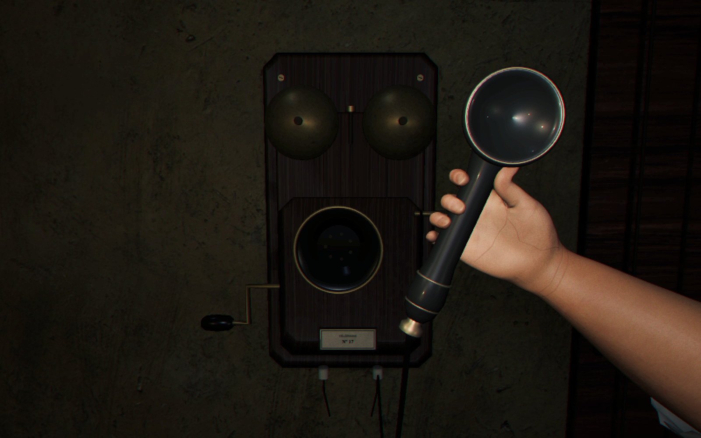

# Natural receiver grip

The user's grip references show four curled fingers, the thumb resting lengthwise against the receiver, and an upright listening position. The first revision still displayed the receiver sideways with the back of the hand facing the camera. The revised pose turns the palm inward, puts the ear cup above the thumb, and brings the arm in from the right with a straighter wrist. The smooth answering lift takes 650 ms.

Each finger's anatomical phalanx lengths fit the receiver's 26 mm handle. The little finger has a smaller curl, while the thumb pad rests along the neck rather than folding beneath the fist. The ear cup is now about 80 mm across to fit the hand's proportions. The studio's antique phone retains its separate fixed mouthpiece and listening receiver.

The deformation is authored in `tools/characters/sora_grip.py` and exported to the hand morph mesh and editable Blender/GLB sources. `FirstPersonHands.ts` places the shared receiver at the matching contact point. To regenerate only this runtime pose while preserving other poses and hand textures, use:

```sh
blender -b --factory-startup -P tools/characters/build-sora-hands.py -- --phone-only
```

Validation: 21 hand/phone unit tests passed, including a regression check that the ear cup is above the grip and cord after the answering lift. ESLint and the production build passed. Inspected the settled held pose and receiver stow in the isolated studio browser fixture, with no browser console errors. All six other runtime hand poses were byte-for-byte unchanged by the phone rebuild. This verifies the hand presentation, not a full Episode 1 playthrough.


